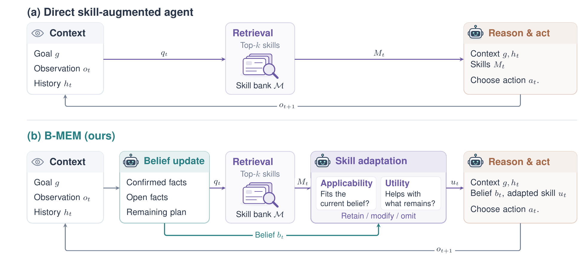

<div align="center">

# 🧠 B-MEM

### Belief-Grounded Procedural Knowledge Use for LLM Agents

[](https://www.python.org/)
[](https://pytorch.org/)
[](https://github.com/vllm-project/vllm)
[](https://github.com/langfengQ/verl-agent)
[](LICENSE)

[📖 Overview](#-overview) •
[🔧 Setup](#-setup) •
[🚀 Inference](#-inference) •
[🎓 Finetuning](#-finetuning-the-7b-student) •
[🔁 RL](#-reinforcement-learning) •
[🙏 Acknowledgements](#-acknowledgements)

<br>



<sub>(a) A direct skill-augmented agent passes retrieved skills to the policy without explicit skill adaptation.
(b) B-MEM updates a natural-language belief state from the agent's actions and observations, assesses each retrieved skill's
<b>applicability</b> under current constraints and its <b>utility</b> for the remaining task objectives, and adapts it into execution
guidance for the policy. A single model π<sub>θ</sub> performs belief updating, skill adaptation, and action selection.</sub>

</div>

---

## 📖 Overview

LLM agents can act more reliably by reusing procedural knowledge, distilled into **skills** and retrieved at inference time.
Adding retrieved skills straight to the context, as in conventional RAG, can lead agents to follow unnecessary or infeasible
procedures. **B-MEM** grounds skill use in an explicit **belief state**.

- 🧭 **Belief.** The agent keeps a natural-language belief about the environment and its task progress, inferred from past actions
  and observations.
- 🔎 **Query.** When it needs procedural knowledge, it writes a short query to a fixed skill bank and retrieves the top-k skills.
- 🛠️ **Adapt.** One adaptation call checks each retrieved skill against the belief for applicability and utility, and turns the
  useful content into execution guidance. Only the guidance enters the policy context.
- 🎯 **Act.** The agent reasons and takes one action.

The same model writes the belief, the query, the adapted guidance, and the action, so B-MEM runs with prompted models, finetuned
students, and as the rollout protocol for reinforcement learning.

### ✨ What's inside

| | |
|---|---|
| 🤖 **Prompted agents** | any model behind an OpenAI-compatible API, policy and adaptation in the same model |
| 🎓 **Finetuned students** | teacher rollouts → SFT of Qwen2.5-7B-Instruct, served locally with vLLM |
| 🔁 **Reinforcement learning** | GRPO with a fixed skill bank and an optional query-count penalty |
| 🧪 **Baselines and ablations** | ReAct, ExpRAG, ReMem, w/o adaptation, and w/o belief conditioning in the same harness |

---

## 📂 Repository layout

```
bmem/
  prompts/        policy system prompts for prompted models and the skill-adaptation prompts
                  (policy_system_bmem.txt, adapt_system.txt, adapt_user.txt; *_nobelief / *_react are baseline variants)
  skill_bank/     alfworld_skill_bank.jsonl: the fixed bank (174 skills: name, description = state_text, content = memory_text)
  games/          pinned game lists (paths relative to $ALFWORLD_DATA): 140 ID, 134 OOD, 200 training games
  tools/          traj_to_sft.py, to_step_rows.py (teacher rollouts -> SFT rows), convert_to_bf16.py, model_merger.py
scripts/
  common.sh       method settings, embedding server, data files (sourced by the scripts below)
  eval_alfworld.sh  inference (prompted model through an OpenAI-compatible API, or a local student through vLLM)
  build_sft_data.sh, train_sft.sh   teacher rollouts -> SFT of Qwen2.5-7B-Instruct
  train_grpo.sh   GRPO with the fixed skill bank (optional query penalty); export_checkpoint.sh -> HF model
agent_system/     environment manager, belief protocol, memory retrieval and skill adaptation, rollout loop
verl/             RL / SFT trainer (verl), API rollout worker
```

<details>
<summary><b>🗺️ Where the method lives in the code</b></summary>

| Component | File |
|---|---|
| Belief protocol (decision-turn instruction) | `agent_system/environments/prompts/belief_alfworld.py` |
| Turn history with belief, query, and guidance | `agent_system/environments/env_manager.py` |
| Skill adaptation (one joint call over the top-k skills) | `agent_system/memory/mem_adaptor_rollout.py` |
| Query penalty | `agent_system/reward_manager/episode.py` |

</details>

---

## 🔧 Setup

Tested with Python 3.12, torch 2.6.0, vLLM 0.8.4, transformers 4.57, ray 2.50, alfworld 0.4.2, textworld 1.7.0, pymilvus 3.0.

```bash
conda create -n bmem python=3.12 -y && conda activate bmem
pip install vllm==0.8.4 && pip install -r requirements.txt && pip install -e .
pip install alfworld==0.4.2 && alfworld-download          # game files under ~/.cache/alfworld (set ALFWORLD_DATA otherwise)
```

> [!NOTE]
> Skill retrieval embeds queries and skill descriptions with BGE-M3 (`BAAI/bge-m3`), which the scripts serve locally with vLLM
> (`EMBED_MODEL` overrides the path). Prompted models need an OpenAI-compatible endpoint and a key in the environment
> (`OPENAI_API_KEY`, or another variable named by `API_KEY_ENV`).

## 🧪 Methods

`METHOD` selects the condition in every script.

| METHOD | Paper name | Belief | Skills given to the policy |
|---|---|:---:|---|
| `bmem` | **B-MEM** | ✅ | one skill adapted to the belief, goal, and current observation |
| `wo_adapt` | w/o adaptation | ✅ | raw top-3 skills |
| `wo_belief_cond` | w/o belief conditioning | ✅ | adapted skill; the adaptation call does not see the belief |
| `exprag` | ExpRAG | ❌ | raw top-3 skills |
| `remem` | ReMem | ❌ | adapted skill (goal and current observation) |
| `react` | ReAct | ❌ | none |

---

## 🚀 Inference

```bash
# prompted model (policy and adaptation are the same model); 140 unique ID games, T = 0.4
METHOD=bmem POLICY=api API_MODEL=gpt-6-luna TOKENIZER_PATH=/path/to/Qwen2.5-7B-Instruct bash scripts/eval_alfworld.sh
METHOD=bmem POLICY=api API_BASE=https://openrouter.ai/api/v1 API_KEY_ENV=OPENROUTER_API_KEY \
  API_MODEL=qwen/qwen3-235b-a22b-2507 REASONING=none TOKENIZER_PATH=/path/to/Qwen2.5-7B-Instruct bash scripts/eval_alfworld.sh

# finetuned 7B student (1-2 GPUs: vLLM policy server and the embedding server)
METHOD=bmem POLICY=local MODEL_PATH=outputs/models/sft_bmem_bf16 bash scripts/eval_alfworld.sh
```

`SPLIT=ood` evaluates the 134 out-of-distribution games. Each run writes `outputs/eval/<tag>/val_traj/0.jsonl` (every policy call
with its full prompt and output, the episode reward, and the game file) and `adaptor_io.jsonl` (every skill-adaptation call), and
prints `val/success_rate`. Environment steps exclude memory queries (`env.memory.count_query_as_step=False`), and an episode ends
at 50 environment steps.

## 🎓 Finetuning the 7B student

The student for each method is trained on successful teacher episodes of that method on 200 training games.

```bash
# 1) teacher rollouts on the training games (seed 7)
METHOD=bmem SPLIT=train POLICY=api API_MODEL=gpt-6-luna TOKENIZER_PATH=/path/to/Qwen2.5-7B-Instruct TAG=teacher_bmem bash scripts/eval_alfworld.sh
# 2) SFT rows: agent turns and skill-adaptation calls of the kept episodes (VARIANT=nobelief for exprag / remem / react)
EXPS='outputs/eval/teacher_bmem_*' VARIANT=full OUT=outputs/data/sft/bmem bash scripts/build_sft_data.sh
# 3) SFT for 100 steps, then cast to bf16 for vLLM
DATA_DIR=outputs/data/sft/bmem NPROC=4 bash scripts/train_sft.sh
python bmem/tools/convert_to_bf16.py outputs/models/sft_bmem_s100/global_step_100 outputs/models/sft_bmem_bf16
# RL initialization: two full epochs instead
DATA_DIR=outputs/data/sft/bmem EPOCHS=2 NPROC=4 bash scripts/train_sft.sh
python bmem/tools/convert_to_bf16.py outputs/models/sft_bmem_ep2/global_step_<N> outputs/models/sft_bmem_ep2_bf16
```

## 🔁 Reinforcement learning

```bash
# GRPO from the SFT initialization, 2 GPUs (policy + rollout; the embedding server shares the last GPU)
MODEL_PATH=outputs/models/sft_bmem_ep2_bf16 TOTAL_STEPS=80 bash scripts/train_grpo.sh
# with the query penalty: reward -1 when the episode's query count is outside [2, 5]
MODEL_PATH=outputs/models/sft_bmem_ep2_bf16 QUERY_PENALTY=1 bash scripts/train_grpo.sh
# export a checkpoint and evaluate it like any student
bash scripts/export_checkpoint.sh outputs/checkpoints/<run>/global_step_<N> outputs/models/grpo_bmem
METHOD=bmem POLICY=local MODEL_PATH=outputs/models/grpo_bmem bash scripts/eval_alfworld.sh
```

| Setting | Value |
|---|---|
| Tasks per step × group size | 16 × 8 |
| Learning rate | 1e-6 |
| KL coefficient | 0.01 (low-variance) |
| Clip range | 0.2 |
| Rollout / validation temperature | 1.0 / 0.4 |
| Validation | every 10 steps on the ID split |

With `QUERY_PENALTY=1`, the first decision is prompted to query and the skill-adaptation responses receive the episode advantage.
The skill bank is never updated.

---

## 🙏 Acknowledgements

This code builds on [verl-agent](https://github.com/langfengQ/verl-agent), released with GiGPO, and on
[MemHarness](https://github.com/KnowledgeXLab/MemHarness), both built on [verl](https://github.com/volcengine/verl). We thank
their authors for releasing their code.

## 📄 License

Apache-2.0 (see [`LICENSE`](LICENSE) and [`NOTICE`](NOTICE)).
